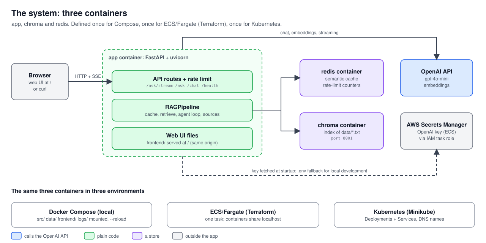
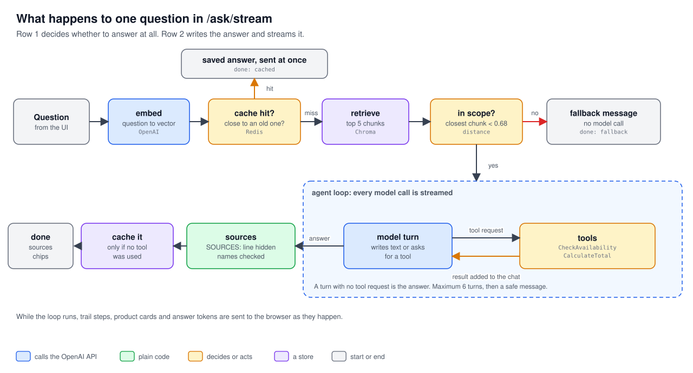
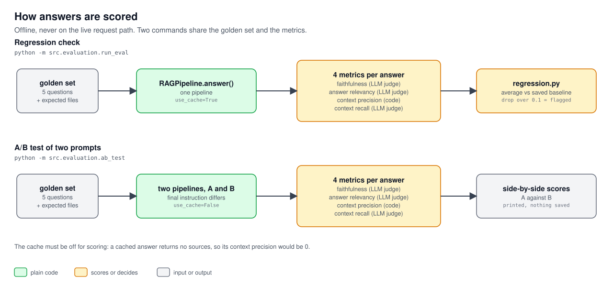

# Production RAG Agent — TrailPeak Outdoors Assistant

[](https://github.com/fanuman/production-rag-agent/actions/workflows/ci-cd.yml)

An agent-powered RAG chatbot, built incrementally over 5+ weeks and deployed on AWS with CI/CD,
IAM-managed secrets, semantic caching, rate limiting, infrastructure defined as code, LLM tracing,
automated regression/A-B evaluation, and a fine-tuning dataset prepared (not yet trained) for a
behavior gap found during evaluation. It has a web UI that shows the assistant's work as it happens:
which documents it searched, which live tools it called, a product card, the streamed answer, and the
sources it actually used.

> **Principle: facts come from documents or tools, never from the model's memory.** Product details and
> policies come from retrieved documents, price and stock come from live function calls, and the answer is
> written only from those. The model is told to treat retrieved text as untrusted data, and the app shows
> the user which sources an answer was based on.

**Status: v1.3 (Week 7) plus a UI and pipeline pass since.** The tagged work is complete (see
[Milestones](#milestones)). After `v1.3` the web UI was redesigned and is now served by the API itself, the
streaming protocol was rebuilt (typed events: `step`, `product`, `token`, `done`, `error`), the agent loop was
collapsed into one streamed loop, a plain question went from 2 model calls to 1, the source chips under an answer
now show only the files the model says it used, the pipeline was split into small modules, the suite grew to
51 tests, API errors became generic (details are logged, never returned), CORS is off unless you ask for it,
the open `/chat` route was removed and `/cost` now reports what every model call has really cost.
The FreightLens capstone is a separate repository:
[`freight-doc-intelligence`](https://github.com/fanuman/freight-doc-intelligence).

## What it does

The assistant answers questions for **TrailPeak Outdoors**, a fictional outdoor gear retailer.
Product details and store policies come from RAG over real documents; current price and stock come
from live function-calling tools; multi-step requests (checking several products, then totaling
their cost) are handled by a genuine ReAct agent loop, not a single tool call. Repeated or
paraphrased questions can be served from a Redis-backed semantic cache instead of re-running the
full pipeline, and every expensive endpoint is rate-limited. Every request through the
non-streaming `/ask` path is traced in LangSmith — the answer call and retrieval, visible as one
structured trace rather than raw logs. A golden-set
evaluation harness scores every response on faithfulness, answer relevancy, context precision, and
context recall, with automated regression detection against a saved baseline and an A/B test
runner for comparing prompt variants. A small fine-tuning dataset exists for one behavior gap that
evaluation surfaced (inconsistent "we don't carry that" responses), uploaded but deliberately not
yet trained on — see Known gaps. The app is defined as three containers — `app`, `chroma`, `redis`
— run together via Docker Compose locally and deployed to ECS/Fargate through Terraform, with the
OpenAI API key supplied entirely by AWS Secrets Manager via an IAM task role — no access key or
`.env` secret exists on the deployed infrastructure at all.

## Demo

<!-- TODO: add the demo video link here when it is ready:
[](VIDEO_URL) -->

*Demo video: coming soon.*

### The web UI

Open `http://localhost:8000/` once the stack is running. The page is served by the API (same origin), so there is
nothing to configure. Add `?demo` to the address to run the page on canned answers without calling the model.

- **A trail instead of a spinner.** While the model works you see what it is doing: "Searching store documents",
  "Checking live stock" (with the SKU), "Adding the prices". Each row flips from running to done.
- **A product card** appears when the assistant checks live stock for a product.
- **The answer streams in word by word**, as markdown.
- **Source chips** under the answer name the documents the answer was based on (see
  [Where the source chips come from](#where-the-source-chips-come-from)).
- **Light and dark mode** follow the system setting.
- **Plain error messages**: past the rate limit (10 requests a minute) the page says
  "You are asking faster than the desk can answer. Wait a moment and try again." instead of failing silently.

<!-- Screenshots to add (save in docs/images/ and un-comment):


-->

## How it works



**What the picture shows.** The app is three containers: `app` (FastAPI, the pipeline, and the web UI),
`chroma` (the vector store) and `redis` (the semantic cache and the rate-limit counters). The same three containers are
defined once for Docker Compose (local) and once for ECS/Fargate (Terraform), and a third time as Kubernetes manifests
for Minikube.

### The path of one question



Every question to `/ask/stream` goes through these steps:

1. **Embed** the question and look for a close earlier question in the Redis cache. A hit is served without calling the model.
2. **Retrieve** the closest chunks from Chroma. If nothing is close enough, the app answers with a fixed
   greeting that lists what it can help with (the out-of-scope path), without calling the model.
3. **Agent loop.** The model sees the question and the retrieved context. It either asks for a tool
   (`CheckAvailability`, `CalculateTotal`) or writes the answer. Tool results go back to the model and the loop repeats,
   at most `max_iterations` times.
4. **Answer.** The turn with no tool request is the answer, and its text is streamed to the browser as it is produced.
5. **Cache** the answer, but only if no tool was used (live price and stock would go stale).

### What the browser receives

`/ask/stream` sends [Server-Sent Events](https://developer.mozilla.org/en-US/docs/Web/API/Server-sent_events):
each event is `event: <name>` and `data: <json>` followed by a blank line. The data is always JSON, so a newline
inside a streamed token can never break the framing.

| Event | Data | When |
|---|---|---|
| `step` | `{id, label, detail, status}` | A row of the trail starts (`running`) or finishes (`done`) |
| `product` | the product's fields | A stock check found the product |
| `token` | `{t}` | The next piece of answer text |
| `done` | `{sources, cached, fallback}` | The answer is complete; `sources` are the chips to show, `fallback` is true for the out-of-scope greeting or a loop that hit its cap |
| `error` | `{message}` | Something failed; the message is generic and the details are only logged |

### Where the source chips come from

For the **streamed** answer, the prompt asks the model to end with one extra line, `SOURCES: file1.txt, file2.txt`
(or `SOURCES: none`), naming only the documents it used. The app hides that line from the stream (`SourcesFooter`
holds back any tail of text that might be the start of the marker, so even a split like `SO` + `URCES:` never shows),
then `resolve_sources()` turns it into the chips:

- no footer, or a footer naming nothing we retrieved: show every retrieved file (safe fallback)
- `SOURCES: none`: show no chips
- otherwise: show only the named files that were really retrieved, in retrieval order (a made-up file name is ignored)

The footer is the model's own report, so it can differ a little from run to run. The instruction only works when it
sits directly after the question in the user message, not in the system message.
The non-streaming `/ask` still gets its `sources` from the structured final call (`sources_used`).
Cached answers return no sources, because the cache never stored them.

**`rag/pipeline.py`** — `RAGPipeline` runs a genuine ReAct loop (Day 16's pattern): the model can
call `CheckAvailability` and `CalculateTotal` in sequence, with each step's input depending on the
real output of the step before it (e.g., totaling two products' prices only after actually looking
both up) — not a single round of tool calling. A `max_iterations` cap fails safely, reporting
incompleteness honestly rather than guessing from partial steps if the loop can't converge.
`answer()` and `retrieve()` are decorated `@traceable`, so every non-streaming request produces one
nested LangSmith trace matching the real call structure with no manual wiring. A `use_cache`
constructor flag (default `True`) lets evaluation code bypass the
semantic cache entirely — without it, a cache hit silently reuses a *previous* pipeline
configuration's answer, which broke the A/B test's independence between variants before the flag
was added (see Known gaps for the residual scoring implication).

The loop is written once (`_agent_loop`) and every model call in it is streamed (`_model_turn`). The
turn in which the model asks for no tool *is* the answer, so a plain question costs one model call.
`answer_stream()` forwards the loop's events live; `answer()` (used by `/ask` and the evaluation harness)
runs the same loop to the end and then makes one extra structured call, because `ab_test.py` varies that call's
instruction and `context_precision` reads the `sources_used` it returns. Small helpers live in their own files:
`rag/models.py` (the data classes), `rag/events.py` (the wording of the trail), `rag/sources_footer.py`
(the sources footer, below) and `api/streaming.py` (SSE framing).

**`core/semantic_cache.py`** — `SemanticCache` checks whether an incoming query is close enough
(cosine distance over its embedding) to a previously answered query to reuse that answer instead
of re-running retrieval and generation. Deliberately never caches an answer that used a tool
(live price/stock data would go stale) or a fallback/incomplete answer (a cached failure would
become a *recurring* failure for the cache's TTL). `REDIS_HOST` is read from the environment,
defaulting to Compose's `"redis"` DNS name locally; ECS's task definition overrides it to
`"localhost"`, since containers within one Fargate task share a network interface rather than
getting individual service DNS names the way Compose provides.

**`retrieve()` fetches its Chroma collection fresh on every call**, not once at pipeline
construction — a deliberate fix, not an oversight. Caching the collection reference at startup
could be worked around on Docker Compose (restart the `app` container alone, `chroma`'s data
survives), but has no equivalent on ECS: any task replacement is a wholly new task with an empty
Chroma, so the old restart-based workaround would loop the same failure indefinitely there.

**`ingest.py`** — deletes and recreates the Chroma collection from `data/*.txt` on every run,
guaranteeing a clean rebuild rather than accumulating stale or colliding chunk IDs. Chunk IDs are
content-derived hashes (filename + position), not a raw incrementing counter. Run manually,
post-deployment, against whichever Chroma instance is currently live — no longer a CI step (see
Known gaps for why that changed).

**`core/secrets.py`** — fetches `OPENAI_API_KEY` from AWS Secrets Manager at startup via `boto3`,
authenticating through whatever identity is already available (an IAM role in production,
`numan-dev`'s local AWS credentials in dev) — no access key is ever placed on a server. Falls back
to `.env` (with a logged warning, not a silent swallow) if Secrets Manager is unreachable, so
local development without AWS credentials configured still works.

### The API

| Method and path | What it does |
|---|---|
| `GET /health` | Liveness check: `{"status": "ok"}` |
| `POST /ask/stream` | The main endpoint: the question's answer as Server-Sent Events (table above). Rate limited to 10/minute |
| `POST /ask` | The same question answered in one JSON response (`reply`, `sources`, `used_fallback`, `from_cache`). Rate limited to 10/minute. Used by the evaluation harness |
| `GET /cost` | Totals for every model call the app has made, read from `logs/cost_log.jsonl`: `total_calls`, `total_cost_usd`, `cost_if_gpt4o_usd` and `by_stage` (same numbers as `python -m src.cost.report`). Public like `/health`, and totals only. On ECS the log lives in the container, so it covers spend since the task last started |
| `GET /` | The web UI (static files, mounted last so it cannot shadow an API route) |

Validation errors come back as `422` before any paid call is made. Upstream failures return a generic `502`
("Upstream error. Please try again."); the real exception is logged on the server. CORS is off, because the UI is
same-origin; if you host the UI elsewhere, set `CORS_ORIGINS="https://my-ui.example.com,http://localhost:5173"`.

## Evaluation



**`evaluation/`** — `golden_set.py` holds a fixed set of test questions with expected sources, the
shared baseline both regression testing and A/B testing compare against. `metrics.py` scores
faithfulness and answer relevancy (LLM-as-judge, structured output) plus context precision
(deterministic — checks retrieved source *files* against expected ones) and context recall
(LLM-judged — did retrieval find *enough*, tolerant of irrelevant content mixed in). `regression.py`
saves a baseline and flags any future run where a metric drops by more than a threshold.
`ab_test.py` runs the golden set through two differently-configured pipelines and compares real
scores rather than eyeballing sample answers.

**Latest run (after the streaming and sources-footer changes), against the saved baseline** — 5 golden questions,
`REGRESSION_THRESHOLD` 0.1:

| Metric | Baseline | Latest | How it is scored |
|---|---|---|---|
| Faithfulness | 0.96 | 0.93 | LLM judge: is every claim supported by the context? |
| Answer relevancy | 0.96 | 0.96 | LLM judge: does the answer address the question? |
| Context precision | 1.00 | 1.00 | Code: are the cited source files the expected ones? |
| Context recall | 0.80 | 0.80 | LLM judge: did retrieval find enough? |

**Read these numbers carefully.** Five questions is a small set, and two of the four metrics are scored by another
LLM, which varies from run to run (see the `REGRESSION_THRESHOLD` and `context_precision` notes in Known gaps). The 0.03
dip in faithfulness is inside the threshold and inside the noise documented there, so it is not read as a regression. The
point of the harness is to notice a drop of the size that a real change causes, not to claim a precise score. The recall
of 0.80 is a known catalog gap (no winter-rated tent), not a retrieval bug.

## Cost tracking

**`cost/`** — `tracker.py`'s `cost_tracker.record(model, input_tokens, output_tokens, label)` is
called after every `chat.completions` call in `rag/pipeline.py`: each agent-loop turn that asks for a tool
(`agent_iteration`), the streamed answer turn (`stream_answer`), and the structured final call that only
`/ask` still makes (`final_answer`). Streamed calls use `stream_options={"include_usage": True}`,
since token usage isn't included in a streamed response by default (without it, no cost is logged at all).
`pricing.py` holds a small
per-model USD-per-million-token table and is the only place that computes a dollar amount.
Deliberately **does not implement actual cheap/expensive model routing** — every call still uses
`gpt-4o-mini` — but each recorded call also logs what the *same* token counts would have cost on
`gpt-4o`, purely as arithmetic on numbers already in hand, so the routing argument has real
evidence behind it without ever spending on the pricier model. `report.py` reads the persisted
`logs/cost_log.jsonl` (not just in-process memory), so cost visibility survives across separate
CLI/API runs. See Known gaps for what this doesn't cover yet.

## More modules

**`agents/`** — a genuine multi-agent pipeline (LangGraph `StateGraph`), entirely separate from
`rag/pipeline.py` and the live `/ask` chat agent. `researcher_node()` retrieves from the same
Chroma collection the chatbot uses, but is instructed to output plain factual bullet points only -
no prose, no marketing language. `writer_node()` takes only those facts and drafts a customer-
facing buying-guide paragraph, never touching the vectorstore directly. The split is enforced by
each node's own narrow prompt, not by any code-level restriction - confirmed working by testing a
topic (`"winter camping tents"`) with a known, real content gap (Day 27's finding: no tent in the
catalog is actually winter-rated) and watching that limitation survive the handoff between both
agents honestly instead of getting lost or glossed into false copy.

**`finetuning/`** — a small, standalone module, not wired into `RAGPipeline` or the API at all.
`training_data.py` defines 12 examples teaching a consistent three-part structure (acknowledge the
gap, offer the closest real alternative, offer to help further) for questions about products
TrailPeak doesn't carry — directly motivated by a real inconsistency `context_recall` surfaced
during evaluation. `upload_and_train.py` uploads the dataset (free) and stops; job creation
(the step that actually costs money to train, and produces a model that costs more per token at
inference) is written but deliberately left commented out. No fine-tuned model currently exists
for this project — see Known gaps.

**`finetuning/bedrock_comparison.py`** — also standalone (and, admittedly, misplaced under
`finetuning/` rather than its own module — see Known gaps), this script calls the same prompt
against the OpenAI API and against AWS Bedrock's Converse API for the same Claude model, side by
side, to compare latency and output directly rather than by reputation. Uses
`eu.anthropic.claude-haiku-4-5-20251001-v1:0` — the *inference profile* ID, not the raw model ID,
which several newer/higher-demand Bedrock models require instead of plain on-demand throughput.

Also in the repo: `infra/lambda/lambda_app.py` (a scoped-down serverless deployment of `/health` and `/chat` only),
`infra/k8s/` (the three containers as Kubernetes Deployments and Services; see [`infra/README.md`](infra/README.md)),
and `locustfile.py` (load testing used to verify rate limiting and caching under concurrent traffic).

## Security and monitoring

- **Input validation.** Pydantic checks length and rejects blank input on every chat and RAG request before any paid API call.
- **Prompt-injection defense.** The RAG agent has a real system prompt that frames retrieved context as untrusted data rather than instructions.
- **No secret on the server.** `core/secrets.py` reads the OpenAI key from AWS Secrets Manager through an IAM role. No access key or `.env` secret exists on the deployed infrastructure.
- **Generic errors.** Clients get "Upstream error. Please try again."; the details stay in the server log.
- **No open model endpoint.** The general-purpose `/chat` route was removed; every model call the API makes goes through the RAG pipeline.
- **CORS off by default**, and rate limiting (`slowapi`, Redis-backed) on every expensive endpoint.
- **Key rotation** needs no code change; the runbook is in [`infra/README.md`](infra/README.md#rotate-the-openai-api-key).
- **CloudWatch monitoring** (`infra/terraform/monitoring.tf`): a log metric filter turns the Secrets Manager fallback warning into an alertable metric, CPU and memory alarms watch the ECS service, an SNS email channel notifies, and a dashboard combines them. It was validated with a real fire drill (a deliberately corrupted secret), not only a `terraform apply`.

## Testing and CI

```bash
python -m pytest tests/
```

51 tests, none of which call OpenAI, Chroma or Redis (they use fakes), so they run in about 3 seconds:
`test_stream_events.py` (the pipeline's events, tools, cache, loop cap and sources), `test_sources_footer.py`
(the footer, including text cut into pieces at every possible position), `test_sse.py` (the wire format and the generic error),
`test_cost_summary.py` (the `/cost` totals, and that `/chat` is gone), `test_prompts.py` and `test_imports.py`.

**`.github/workflows/`** — a two-job pipeline: `test` (fast import-checks) gates `build-and-push`
(builds the Docker image, pushes to ECR tagged by both commit SHA and `latest`).

On every push to `main`, the `test` job installs the requirements and runs `pytest tests/`; `build-and-push` runs only if it passes.
CI builds and pushes the image; it does not deploy it (see Known gaps).

## Quick start

**1. Install dependencies**
```bash
python -m venv venv
source venv/bin/activate
pip install -r requirements.txt
```

**2. Local config** — create `.env` in the repo root with `OPENAI_API_KEY=sk-...`. This is used
directly for local development; in production, Secrets Manager takes over automatically.

**2b. Optional: enable LangSmith tracing** — add to `.env`:
```
LANGCHAIN_TRACING_V2=true
LANGCHAIN_API_KEY=ls__...
LANGCHAIN_PROJECT=production-rag-agent
```
Traces appear at smith.langchain.com under the `production-rag-agent` project. Only the
non-streaming `/ask` path is traced (see Known gaps). Without these variables set, the app runs
identically — `@traceable` is a no-op if tracing isn't configured.

**3. Run locally via Docker Compose** (recommended — matches the deployed three-container shape)
```bash
docker compose up --build
```
`src/`, `data/`, and `logs/` are bind-mounted into the `app` container, and its command overrides
the Dockerfile's `CMD` to add `--reload` — so editing code under `src/` restarts the app inside the
container automatically, no rebuild needed, and files like `logs/cost_log.jsonl` are readable
directly from the host. The override lives in `docker-compose.yml`, not the Dockerfile itself,
because that same Dockerfile is what CI/CD builds and pushes to ECR for the ECS/Fargate deployment
— baking `--reload` into the image would ship a dev-only file-watcher into production. A rebuild
(`--build`) is still needed whenever `requirements.txt` changes; the mount only covers code edits.

Then, in a separate terminal, ingest into the running stack:
```bash
CHROMA_HOST=localhost CHROMA_PORT=8001 python -m src.ingest
```
```bash
curl -X POST http://localhost:8000/ask \
  -H "Content-Type: application/json" \
  -d '{"message": "How much would the StormShield jacket and TrekLight poles cost together?"}'
```

**4. Run without Compose** (Chroma/Redis run separately, or point at a remote instance)
```bash
uvicorn src.api.main:app --reload
```

Then open **http://localhost:8000/** for the web UI, or stream from the terminal:
```bash
curl -N -X POST http://localhost:8000/ask/stream \
  -H "Content-Type: application/json" \
  -d '{"message": "Can I return a product with a manufacturing defect?"}'
```

**Running Python scripts outside Docker** (the evaluation harness, `ingest`, `cost.report`) needs
`REDIS_HOST=localhost CHROMA_HOST=localhost CHROMA_PORT=8001`, because the defaults are the Compose service
names (`redis`, `chroma`).

### More commands

**6. Load test** (against a local Compose stack, not live AWS infrastructure)
```bash
locust -f locustfile.py --host=http://localhost:8000
```
Opens a web UI at `localhost:8089`.

**7. Run the evaluation harness** (offline, deliberately not on the live request path). Both
commands below need Chroma/Redis reachable — via Compose (`CHROMA_HOST=localhost
CHROMA_PORT=8001 REDIS_HOST=localhost`) or another live instance. `run_eval.py` runs
with the semantic cache bypassed (`use_cache=False`), so no Redis flush is needed: a cached answer carries no sources and
would score `context_precision` 0 for reasons unrelated to retrieval (see Known gaps).

```bash
python -m src.evaluation.run_eval
```
Scores the golden set on faithfulness, answer relevancy, context precision, and context recall.
First run saves a baseline (`baseline_scores.json`, gitignored); later runs flag any metric that
drops by more than `REGRESSION_THRESHOLD` (currently an uncalibrated initial guess — see Known
gaps).

```bash
python -m src.evaluation.ab_test
```
Compares two `final_answer_instruction` variants on the same golden set, with `use_cache=False`
on both — required, since a cache hit would silently return one variant's old answer to the
other's test, invalidating the comparison.

**8. Fine-tuning dataset (prepared, not trained)**
```bash
python -m src.finetuning.training_data       # writes datasets/no_match_pattern.jsonl
python -m src.finetuning.upload_and_train    # uploads the file (free); stops there
```
To actually train (costs real money — see Known gaps), open `upload_and_train.py` and uncomment
the `create_job(...)` call at the bottom before re-running.

**9. Compare OpenAI vs. AWS Bedrock** (needs AWS credentials with Bedrock access — see Known gaps
for the exact IAM permissions this required)
```bash
python -m src.finetuning.bedrock_comparison
```
Calls the same prompt against both `gpt-4o-mini` and `eu.anthropic.claude-haiku-4-5-20251001-v1:0`
(a Bedrock inference profile, not a raw model ID) and prints latency + output for both.

**10. Cost tracking report** (needs at least one `/ask` request made first, so there's something
to report on)
```bash
python -m src.cost.report
```
Prints total calls, actual cost, what the same calls would have cost on `gpt-4o` instead, and a
breakdown by pipeline stage (`agent_iteration`, `stream_answer`, `final_answer`). Reads `logs/cost_log.jsonl`
directly, so it works the same whether requests came from `cli.py` or the API.

**11. Run the Researcher + Writer content pipeline** (needs `langgraph`; `pip install langgraph`
locally, or `docker compose up --build` to pick it up in the container)
```bash
docker compose exec app python -m src.agents.graph "winter camping tents"
```
Prints the Researcher's raw facts, the sources they came from, and the Writer's final draft.
Try a topic with a real content gap (as above) and a cleanly-supported one (e.g.
`"rain jackets"`) to see both the honesty case and the normal case.

## Deploy to AWS

The current deployment is ECS/Fargate defined in Terraform: the same three containers, a cluster, IAM roles, a
security group, a CloudWatch log group and the monitoring stack. The step-by-step runbooks are in
**[`infra/README.md`](infra/README.md)**:

- [Deploy to ECS/Fargate with Terraform](infra/README.md#deploy-to-ecsfargate-with-terraform-current-recommended-path) (and `terraform destroy` when done)
- [Rotate the OpenAI API key](infra/README.md#rotate-the-openai-api-key)
- [Kubernetes on Minikube](infra/README.md#kubernetes-on-minikube)
- [Legacy manual EC2 path](infra/README.md#quick-redeploy-ec2--legacy-path-see-known-gaps) (kept for reference, not maintained)
- [Cleanup checklist](infra/README.md#cleanup-checklist-end-of-roadmap)

**Every task replacement means a brand-new, empty Chroma**, so ingestion is a required step after every deploy that touches
the task definition, not a one-time setup step.

**Live demo.** Deployed on ECS/Fargate via Terraform — destroyed between active use to avoid ongoing cost
(`terraform destroy`). Redeploy via the [runbook](infra/README.md#deploy-to-ecsfargate-with-terraform-current-recommended-path);
the image is always current in ECR via the CI/CD pipeline.

## Project layout

```
production-rag-agent/
├── src/
│   ├── cli.py
│   ├── ingest.py
│   ├── core/
│   │   ├── config.py
│   │   ├── embeddings.py
│   │   ├── vectorstore.py
│   │   ├── llm_client.py      # used by cli.py and the Lambda app
│   │   ├── secrets.py
│   │   └── semantic_cache.py
│   ├── tools/
│   │   ├── inventory_tool.py
│   │   ├── calculator_tool.py
│   │   └── inventory.json
│   ├── rag/
│   │   ├── prompts.py         # system prompt, answer prompt, the SOURCES: footer instruction
│   │   ├── pipeline.py        # RAGPipeline: _agent_loop, _model_turn, answer, answer_stream
│   │   ├── models.py          # data classes: FinalAnswer, ToolRequest, Turn, LoopResult, Prepared
│   │   ├── events.py          # wording of the trail ("Checking live stock", ...)
│   │   └── sources_footer.py  # hides the SOURCES: line from the stream; resolve_sources()
│   ├── evaluation/
│   │   ├── prompts.py
│   │   ├── metrics.py         # faithfulness, relevancy, context precision/recall
│   │   ├── golden_set.py      # fixed test questions + expected sources
│   │   ├── regression.py      # baseline save/compare
│   │   ├── ab_test.py         # compare two pipeline configurations
│   │   ├── baseline_scores.json  # gitignored - generated locally, not committed
│   │   └── run_eval.py
│   ├── finetuning/
│   │   ├── training_data.py           # 12 examples, "no good match" response pattern
│   │   ├── datasets/
│   │   │   └── no_match_pattern.jsonl # generated, small enough to commit
│   │   ├── upload_and_train.py        # upload runs; job creation left commented out
│   │   └── bedrock_comparison.py      # OpenAI vs. Bedrock Converse API, side by side
│   ├── cost/
│   │   ├── pricing.py         # per-model USD/1M-token table
│   │   ├── tracker.py         # records real usage + hypothetical gpt-4o cost
│   │   └── report.py          # summarize() for GET /cost + terminal report from logs/cost_log.jsonl
│   ├── agents/
│   │   ├── state.py           # ContentState TypedDict
│   │   ├── researcher.py      # Chroma retrieval -> plain facts only
│   │   ├── writer.py          # facts only -> customer-facing draft
│   │   └── graph.py           # StateGraph: researcher -> writer -> END
│   └── api/
│       ├── main.py            # routes, rate limiting, serves the UI
│       ├── streaming.py       # SSE framing + generic error event
│       └── models.py
├── tests/
│   ├── test_stream_events.py
│   ├── test_sources_footer.py
│   ├── test_sse.py
│   ├── test_prompts.py
│   ├── test_cost_summary.py
│   └── test_imports.py
├── frontend/
│   └── index.html             # the web UI, served by the API at /
├── docs/
│   ├── images/                # the three diagrams (SVG)
│   └── diagrams/build_diagrams.py  # regenerates them (no dependencies)
├── infra/
│   ├── README.md            # deploy / rotate / Kubernetes / EC2 / cleanup runbooks
│   ├── Dockerfile           # now also COPYs data/ - see Known gaps
│   ├── k8s/
│   │   ├── redis.yaml
│   │   ├── chroma.yaml
│   │   └── app.yaml         # CHROMA_HOST/REDIS_HOST as Service DNS names; openai-secret via secretKeyRef
│   ├── lambda/
│   │   └── lambda_app.py
│   └── terraform/
│       ├── providers.tf
│       ├── data.tf
│       ├── iam.tf
│       ├── variables.tf
│       ├── ecs.tf
│       ├── monitoring.tf       # SNS topic, log metric filter, CPU/memory + secret-fallback alarms, dashboard
│       └── terraform.tfvars    # gitignored - personal IP + alert email, not committed
├── data/                    # original source documents - committed, not gitignored
├── chroma_db/               # persisted index - gitignored, rebuilt from source every time
├── logs/                    # cost_log.jsonl - gitignored, generated locally
├── docker-compose.yml
├── locustfile.py
├── .github/workflows/
├── requirements.txt
└── .env                     # local dev fallback only - not committed
```

Regenerate the diagrams with `python docs/diagrams/build_diagrams.py`.

## Known gaps

Everything below is deliberate and written down. Items marked **Fixed** were gaps once; they are kept so the history stays honest.

### Pipeline and API

- **`/chat` was an open, general-purpose model on the owner's key**, with no retrieval and only a short
  system prompt, and **`/cost` reported only `/chat`'s counters** (not `/ask` or `/ask/stream`).
  **Fixed**: the FastAPI `/chat` route was removed (`llm_client.py` stays for `cli.py` and the Lambda app), and
  `/cost` now returns the totals from `logs/cost_log.jsonl`, the same numbers as `python -m src.cost.report`.
- **New: the sources footer is the model's self-report**, so the chips can vary from run to run (one run listed only the
  warranty file for a question that used both policies). If a pattern appears, the options are to require listing a file if even one
  fact came from it, or to lower the temperature.
- **New: `/ask` still makes a separate structured final call**, which streamed questions no longer need. It stays because
  `ab_test.py` varies that call's instruction and `baseline_scores.json` was measured that way. Removing it is a later, deliberate
  change that needs one re-baseline.
- **New: there is no conversation memory.** Every question is answered on its own.
- **`SemanticCache` never captures `sources`** — every cached response permanently returns
  `sources: []`, even though the original (non-cached) answer had real sources. This also means
  any cached answer scores `context_precision: 0.0` by construction (empty source list), unrelated
  to real retrieval quality — evaluation code must run with `use_cache=False` to get meaningful
  precision scores. A known, minor gap in `SemanticCache.store()`'s signature, not fixed yet.
- **Only the non-streaming path is traced.** `answer_stream()` uses `yield`; tracing a generator
  correctly needs more care than the current `@traceable` setup provides, so `/ask/stream`
  requests currently produce no LangSmith trace at all.
  Since the pipeline cleanup, the `agent_loop` span no longer exists; only `rag_answer` and `retrieve` are traced.
- **The streaming endpoint's source list is less precise** than the non-streaming one — a
  validated structured-output pass and true token streaming are in real tension.
  **Fixed** for the web UI by the `SOURCES:` footer (see [Where the source chips come from](#where-the-source-chips-come-from)); `/ask` keeps its structured call.
- **The frontend (`frontend/index.html`) points at a hardcoded `API_BASE`** — update it manually
  to match wherever the app is currently deployed.
  **Fixed**: the UI is now served by the API itself (same origin), so there is no `API_BASE` to edit.
- **A narrow retrieval edge case**: some natural phrasings of meta-questions ("what does your
  company sell") don't score well enough against `about_us.txt` to beat the relevance threshold,
  and raising the threshold isn't a safe fix (a known-irrelevant query scored better than a second
  genuine meta-question in testing) — the real fix is more naturally-phrased content in
  `about_us.txt`, not a threshold change.
- **The semantic cache is deliberately conservative** — real testing found that paraphrased
  questions can score *farther apart* in embedding distance than genuinely different questions on
  adjacent topics, so the threshold favors missing some real cache hits over ever risking a wrong
  cached answer.
- **Embedding calls aren't cost-tracked.** `get_embedding()` (`text-embedding-3-small`) runs at the
  top of both `answer()` and `answer_stream()` but isn't wired into `cost/tracker.py` — real cost,
  but roughly two orders of magnitude cheaper than a chat completion at this scale, so it was left
  out of today's scope rather than treated as a meaningful gap in the totals.

### Evaluation

- **`REGRESSION_THRESHOLD` (0.1) is an initial guess, not calibrated** against actual measured
  run-to-run LLM-judge variance. A live example was found during Day 27's A/B testing: the same
  question, essentially the same answer text, scored `faithfulness` 0.33 in one run and 1.00 in
  another purely from judge inconsistency — exactly the kind of noise the threshold needs to
  tolerate without either missing real regressions or crying wolf constantly.
- **`context_precision` depends on `parsed.sources_used`**, which is the model's own self-reported
  list of sources from the final structured-output call, not an independently verified ground
  truth — some precision variance between otherwise-similar runs may come from this self-report
  shifting slightly rather than retrieval itself changing.
- **`run_eval.py` ran with the cache on**, so Redis had to be flushed before a run, or cached answers (which carry
  no sources) scored `context_precision` 0. **Fixed**: `run_eval.py` now builds `RAGPipeline(use_cache=False)`, like `ab_test.py`.
- **Two mislabeled content bugs found via LangSmith trace inspection, not yet fixed:**
  `product_catalog.txt`'s SummitCarry Backpack entry contains a chunk of tent-specific content
  (DAC poles, rainfly, "tent body" in the included-items list) — almost certainly a copy-paste
  error. Similarly, a "REFUND TIMING" section in the returns/warranty policy content actually
  describes warranty proof-of-purchase requirements, not refund processing time. **Confirmed that
  context precision and context recall, as currently designed, cannot detect either bug** —
  precision only checks retrieved source *files* (both bugs sit inside correctly-named files), and
  recall is deliberately tolerant of irrelevant content as long as sufficient correct content is
  present alongside it. Both need a dedicated data-quality pass; a future "does each chunk's
  content match its claimed topic" check would be a different kind of metric than either.
  **Fixed**: the data files now read correctly (re-run `python -m src.ingest` to pick up the change).
- **A real content gap found via `context_recall`**: no tent in the catalog is actually rated for
  winter camping — the only tent (AlpinePeak) is explicitly 3-season only. Not a bug; a genuine
  product-catalog limitation worth a business decision (add a winter-rated SKU, or make the
  limitation explicit in the assistant's answer). The Day 28 fine-tuning dataset addresses how the
  assistant *talks about* this kind of gap generally, not the underlying catalog gap itself.

### Cost and models

- **No actual cheap/expensive model routing is implemented** — every call still runs on
  `gpt-4o-mini`. `cost/tracker.py` logs what the same token counts *would* cost on `gpt-4o`
  purely as a hypothetical, deliberately without ever calling it, so the routing argument has real
  numbers behind it without spending on the pricier model. Whether to actually build routing logic
  (and on what signal — keyword heuristic, a cheap classifier call, or a fallback-on-failure
  pattern) is an open decision, not done here.
- **No fine-tuned model exists yet.** The Day 28 dataset (12 examples) is uploaded but the
  training job was deliberately never submitted — training is charged per token (multiplied by
  epochs, default 3) and the resulting model costs more per token at inference, ongoing. A
  12-example dataset is also genuinely small for a production-quality result (50-100+ varied
  examples would be a more realistic target); running the job today would have spent real money
  for a minimal, not fully reliable improvement. `create_job()` is written and ready, deliberately
  left commented out rather than run by default.
- **The OpenAI vs. Bedrock latency comparison is a single sample per backend** (one call each),
  not a benchmark — a real comparison would need multiple runs to separate genuine latency
  differences from ordinary network/API noise on a given call.

### Infrastructure and deployment

- **ECS rolling deployments behave less predictably without a health check or load balancer.**
  Found live during Day 35's monitoring fire drill: during a `force-new-deployment`, which task ECS
  chooses to retain during scale-down back to `desiredCount: 1` isn't fully predictable - an
  already-established task survived through two separate forced redeployments before eventually
  being replaced on its own timeline, while newer tasks came and went around it. Didn't cause any
  actual downtime (a healthy task was always serving), but made it harder to be certain which task
  a given test request actually hit - direct CloudWatch Logs queries were the reliable way to verify,
  not `curl` alone. A real health check would make this predictable; not added today.
- **CPU/memory alarm thresholds (80% for 2 minutes) are reasonable defaults, not calibrated** -
  never actually tested under real load (a Locust run would be the way to check whether they trigger
  sensibly in practice).
- **API key rotation runbook** (no code change needed - `secrets.py` already fetches the key from
  Secrets Manager at app startup, so task replacement already re-fetches fresh secrets):
  1. Generate a new key on platform.openai.com
  2. `aws secretsmanager put-secret-value --secret-id production-rag-agent/openai-api-key --secret-string '{"OPENAI_API_KEY":"sk-NEW-KEY"}' --region eu-north-1`
  3. `aws ecs update-service --cluster production-rag-agent-tf-cluster --service <service-name> --force-new-deployment --region eu-north-1`
  4. Confirm new tasks are healthy, *then* revoke the old key on platform.openai.com
  - **Related, unfixed gap**: `secrets.py`'s `except` block silently falls back to whatever's in
    the environment on a Secrets Manager failure, only logging a warning - during a rotation
    specifically, a task could keep running on a stale/missing key with nothing actually alerting
    on it. Natural fit for a CloudWatch alarm (Day 35), not fixed today.
    Partly covered since: the Day 35 CloudWatch metric filter and alarm now alert on this fallback.
- **No EKS cluster has actually been deployed yet - deferred twice, deliberately.** Day 33 covered
  EKS fundamentals (managed control plane vs. node groups, IAM-for-ECR image pulls, `LoadBalancer`
  Services, the cost model) as a conceptual walkthrough rather than a live create/test/destroy
  cycle, since Day 32 already covered the underlying Kubernetes concepts hands-on for free. The
  Week 7 Saturday project revisited this and deferred it a second time: standing up a real cluster
  only to tear it back down minutes later (nothing from Week 7's work would persist on it) would add
  AWS spend and session time without teaching anything Day 33 doesn't already have in writing. The
  exact `eksctl` command sequence is recorded in `day-33-notes.md` for whenever a real EKS
  deployment is actually needed - most plausibly Week 8 capstone infra work, where something would
  actually stay deployed for longer than a single session.
- **The orchestrator/specialist router pattern is documented, not built.** Week 7's Saturday
  project originally planned this as a second hands-on LangGraph exercise on top of Day 31's
  pipeline. Deliberately deferred instead: Week 8's capstone already commits to LangGraph as a core
  tool from day one, which is where conditional-edge routing gets real, sustained practice - a
  second lighter exercise today to touch the same primitive once would be duplicated effort.
  `day-31-notes.md` carries the full concept (router vs. pipeline, what `add_conditional_edges`
  formalizes) plus a plain `if`/`elif`/`else` implementation of the same dispatch logic, so the idea
  is precise and ready when Week 8 needs it.
- **`infra/Dockerfile` never copied `data/` into the image at all until Day 32** — only ever
  masked by `docker-compose.yml`'s bind mount, which meant the image itself has never really been
  self-contained. Surfaced because Kubernetes Pods have no equivalent to a host bind mount (see
  Day 32 notes). Fixed with `COPY data/ ./data/` alongside the existing `COPY src/ ./src/`. **Open
  question, not yet checked**: since this exact Dockerfile also builds the production ECS image,
  it's worth confirming whether that deployment has had the same latent gap this whole time, and if
  so, how ingestion there has actually been succeeding.
- **Chroma has no persistent storage in the ECS deployment.** Task replacement (a redeploy, a
  forced restart) always starts with an empty Chroma, requiring manual re-ingestion every time. A
  real fix — EFS-backed storage, or a managed vector store — is future work, not done here.
- **The full RAG pipeline isn't deployed via Lambda.** `infra/lambda/lambda_app.py` demonstrates
  serverless deployment for a scoped-down `/health` + `/chat` subset only — Lambda's package size
  limits and lack of persistent local disk make the locally-persisted Chroma index a poor fit
  without further work.
- **The EC2 deployment path predates Redis/Compose and is not actively maintained** — the current,
  actively-used deployment model is the Terraform/ECS path above.
- **`terraform.tfvars` (the real IP value) is per-person and gitignored** — anyone else running
  this Terraform config needs to supply their own before `apply` will work.
- **New: CI builds and pushes the image but does not deploy it**, and it authenticates to AWS with stored access keys (GitHub OIDC would remove them).
- **New: nothing ingests on startup**, and there is no `/ready` endpoint, so a fresh stack answers "out of scope" until `ingest` is run by hand.
- **New: `requirements.txt` is larger than the app needs** (Flask, locust, gevent, kubernetes, pinecone and probably `chromadb-client` are candidates to drop).

## Milestones

This repo wasn't rewritten each week — it grew. Each Saturday's project built directly on the
last: a containerized chatbot (Week 1) became a real RAG pipeline over a governance corpus (Week
2), then pivoted domains and gained function calling (Week 3), then became a genuine multi-step
agent deployed to real cloud infrastructure with a full CI/CD pipeline (Week 4), then gained
multi-container local dev, Redis-backed caching and rate limiting, and a Terraform-defined
ECS/Fargate deployment replacing hand-clicked console setup (Week 5), then gained LangSmith
tracing, context precision/recall metrics, an automated regression + A/B testing harness, a
fine-tuning dataset for a real behavior gap found through that harness, a side-by-side AWS Bedrock
comparison, and real per-request cost tracking (Week 6), then gained a second multi-agent topology
(a genuine LangGraph Researcher + Writer pipeline), Kubernetes fundamentals demonstrated live on
Minikube, real security hardening (input validation, prompt-injection defenses, a key rotation
runbook), and a full CloudWatch monitoring/alerting stack validated with a real fire drill (Week 7).
The git tags below trace that progression; check tag history, not just the latest commit, to see it.

| Tag | Week | What it added | Status |
|-----|------|---------------|--------|
| `v0.1-week1-chatbot` | 1 | Containerized CLI/API chatbot, production error handling, cost tracking | ✅ |
| `v0.2-week2-rag` | 2 | RAG over a real multi-document corpus, source attribution | ✅ |
| `v0.3-week3-frontend` | 3 | SSE streaming frontend, function calling + RAG, eval harness | ✅ |
| `v1.0-capstone` | 4 | Genuine multi-step agent, deployed on EC2 + ECR + CI/CD, Secrets Manager, IAM roles | ✅ |
| `v1.1-week5-infra` | 5 | Docker Compose, ECS/Fargate via Terraform, semantic caching (Redis), rate limiting, load testing | ✅ |
| `v1.2-week6-observability` | 6 | LangSmith tracing, context precision/recall, regression + A/B testing harness, fine-tuning dataset (prepared, untrained), Bedrock comparison, cost tracking | ✅ |
| `v1.3-week7-hardening` | 7 | LangGraph Researcher + Writer pipeline; Kubernetes fundamentals + local Minikube deployment (self-healing demonstrated live); EKS fundamentals (conceptual, deliberately deferred twice); input validation + prompt-injection hardening + key rotation runbook; CloudWatch monitoring + alerting (SNS, metric filters, alarms, dashboard - validated with a real fire drill). Saturday project: orchestrator/specialist router pattern documented (not built, deferred to Week 8) | ✅ |
| *(untagged)* | after 7 | Web UI redesign served by the API; typed SSE events; one streamed agent loop (a plain question costs 1 model call, not 2); sources footer; pipeline split into modules; generic errors and CORS off by default; open `/chat` route removed, `/cost` reads the real cost log, `run_eval` bypasses the cache; 51 tests; README and `infra/README.md` restructure | ✅ |

<details>
<summary><strong>Tech stack</strong></summary>

- Vanilla HTML/CSS/JS web UI (`frontend/index.html`, no build step), served by the same FastAPI app; talks to
  `/ask/stream` over Server-Sent Events
- Python 3.13, FastAPI + uvicorn
- OpenAI API (`gpt-4o-mini`, `text-embedding-3-small`) — chat, structured output, function
  calling, streaming
- Docker, Docker Compose (local multi-container dev: app + Chroma server + Redis)
- Chroma (vector store), run as its own networked server, not embedded in the app
- Redis (`redis-stack-server`, RediSearch) — semantic response caching, keyed by embedding
  distance rather than exact query match
- `slowapi` — Redis-backed rate limiting, correct across multiple app instances, not just a
  single process
- LangSmith (`langsmith`, `@traceable`) — per-request tracing of the answer call and retrieval (the
  non-streaming path), used standalone (not via LangChain, since the pipeline is hand-built on raw OpenAI
  SDK calls)
- AWS: IAM (users + roles), EC2, S3, Secrets Manager, CloudWatch (logs + alarms), ECR, ECS/Fargate
- Terraform — the primary infrastructure definition for ECS/Fargate: cluster, IAM roles, security
  group, task definition, service, all as reviewable code rather than console clicks
- GitHub Actions (CI/CD: test → build → push to ECR)
- Locust — load testing, used to verify rate limiting and caching under real concurrent traffic
- A hand-built RAG evaluation harness — faithfulness, answer relevancy, context precision, context
  recall (LLM-as-judge where needed), run against a fixed golden set, with baseline-based
  regression detection and an A/B test runner for comparing prompt variants
- OpenAI fine-tuning (Files API + Fine-tuning API) — a prepared training dataset for a specific
  behavior pattern, with the actual training job left as a deliberate, uncommitted decision (see
  Known gaps)
- AWS Bedrock (`boto3`, Converse API) — a second, interchangeable inference backend for the same
  prompt, compared side by side against the OpenAI API directly (`finetuning/bedrock_comparison.py`)
  for latency and output; not wired into `RAGPipeline` itself
- A hand-built cost tracking module (`cost/`) — turns every OpenAI call's real token usage into an
  actual dollar figure, logged per pipeline stage, with a hypothetical-cost comparison against a
  pricier model computed from the same token counts (no extra API spend required to see it)
- LangGraph (`agents/`) — a genuine multi-agent pipeline (Researcher + Writer), separate from the
  live chat agent entirely: generates customer-facing buying-guide content from the same product
  catalog, with each role's job kept narrow (facts only vs. prose only) so the split is real
- Kubernetes (`infra/k8s/`) — the same three-container shape (`app`, `chroma`, `redis`) as
  Compose/ECS, redefined as Deployments + Services, run locally via Minikube; a Kubernetes Secret
  supplies the OpenAI key in place of ECS's Secrets Manager injection
- Security hardening — Pydantic-level input validation on every chat/RAG request (length + blank
  rejection before any paid API call), a real system-level prompt for the RAG agent (previously
  absent entirely) explicitly framing retrieved context as untrusted data rather than instructions,
  and a documented zero-new-code key rotation runbook built on the existing ECS task-replacement
  mechanism
- CloudWatch monitoring (`infra/terraform/monitoring.tf`) — a log metric filter turning the Day 34
  Secrets Manager fallback warning into a real, alertable metric, CPU/memory health alarms on the
  ECS service, an SNS email channel, and a combined dashboard - validated with a real fire drill
  (a deliberately corrupted secret), not just a `terraform apply`
- A separate, scoped-down AWS Lambda + API Gateway deployment (Mangum), demonstrating a second
  deployment model for `/health` + `/chat` only — see Known gaps below for why the full pipeline
  isn't deployed this way

</details>

<details>
<summary><strong>Architecture as text (the original diagram)</strong></summary>

```
                    cli.py                  api/main.py (/ask, /ask/stream, /cost)
                 (terminal chat)              (FastAPI, rate-limited via slowapi)
                        \                          /
                         \                        /
                    core/llm_client.py (used by cli.py and the Lambda app only; the API's /chat route was removed)
                    core/secrets.py -- Secrets Manager fetch, .env fallback for local dev
                    rag/pipeline.py -- RAGPipeline (use_cache flag)
                               |         |          \
                               |         |           \
                   core/embeddings.py  core/       tools/inventory_tool.py (CheckAvailability)
                   core/vectorstore.py semantic_   tools/calculator_tool.py (CalculateTotal)
                        |              cache.py    (both self-register with the pipeline)
                        |              (Redis,
                        |               tool-using/failed
                        |               answers never cached)
                        |
                  Chroma (own container,          Redis (own container,
                  networked, not embedded)         RediSearch + rate-limit counters)

  answer() and retrieve() are @traceable -->  LangSmith
  (non-streaming path only; nested calls form one request tree per query)

  Three containers - app, chroma, redis - defined once in docker-compose.yml (local dev)
  and once in infra/terraform/ecs.tf (ECS/Fargate). Same shape, two environments.

  data/*.txt --ingest.py--> chroma_db/ <-- RAGPipeline.retrieve()
  (run manually, post-deploy,        (a fresh collection reference is
   against whichever Chroma           fetched on every call - not
   is currently live)                 cached at startup)

  golden_set.py --> run_eval.py --> RAGPipeline.answer() (use_cache=True)
                                  --> metrics.py (faithfulness, relevancy,
                                                   context precision/recall)
                                  --> regression.py (vs. saved baseline)

  golden_set.py --> ab_test.py --> two RAGPipeline instances (use_cache=False,
                                    different final_answer_instruction)
                                 --> metrics.py --> side-by-side comparison

  finetuning/training_data.py --> datasets/no_match_pattern.jsonl
                               --> upload_and_train.py --> Files API (uploaded)
                                                         --> Fine-tuning API
                                                             (job creation - NOT yet run;
                                                              standalone, not wired into
                                                              RAGPipeline anywhere)

  finetuning/bedrock_comparison.py --> OpenAI API (chat.completions)
                                    --> boto3 bedrock-runtime.converse()
                                        (eu.anthropic.claude-haiku-4-5-20251001-v1:0,
                                         an inference profile ID, not the raw model ID)
                                    --> side-by-side latency/output comparison
                                        (standalone script, not wired into RAGPipeline)

  rag/pipeline.py (_agent_loop, _model_turn, answer, answer_stream)
       --> cost/tracker.py.record() on every chat.completions call
             --> cost/pricing.py (actual cost + hypothetical gpt-4o cost,
                                   same token counts, no extra API call)
             --> logs/cost_log.jsonl (persists across separate runs/processes)
                     --> cost/report.py (aggregate: total, by model, by stage)

  agents/graph.py (StateGraph: researcher -> writer -> END)
       --> agents/researcher.py (Chroma retrieval -> plain facts only)
       --> agents/writer.py (facts only -> customer-facing draft)
       (standalone content-generation pipeline, separate from rag/pipeline.py
        and the live chat agent entirely - shares only the Chroma collection)

  infra/k8s/*.yaml (app, chroma, redis - Deployment + Service each)
       --> Minikube (local single-node cluster)
       (same three-container shape as docker-compose.yml / ecs.tf, third
        environment's answer to service discovery: Kubernetes Service DNS
        names ("chroma", "redis") rather than Compose's built-in DNS or
        ECS's shared-network-interface "localhost")
```

</details>
